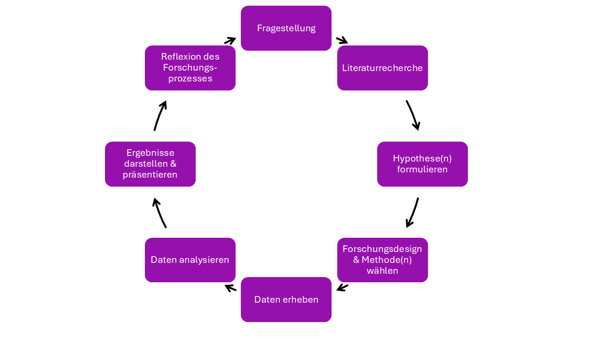
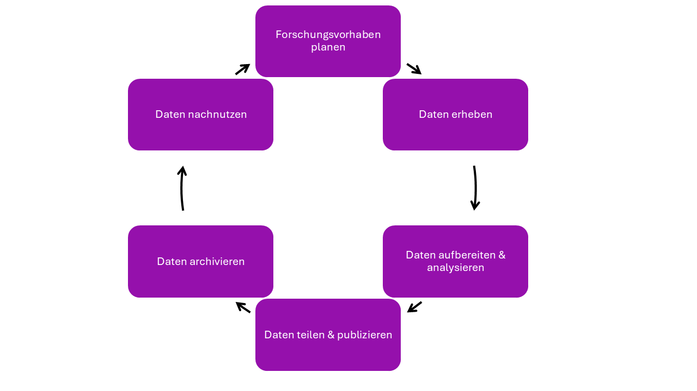

<!--
author:   Jessica Zipf

email:    Jessica.Zipf@uni-konstanz.de

version:  0.0.1

language: de

narrator: US English Female

comment:  Selbstlerneinheit zu den Grundlagen des Forschungsdatenmanagements

link:     https://cdn.jsdelivr.net/chartist.js/latest/chartist.min.css

script:   https://cdn.jsdelivr.net/chartist.js/latest/chartist.min.js

translation: Deutsch  translations/German.md

-->
# Grundbegriffe des Forschungsdatenmanagement

Diese Selbstlerneinheit stellt Grundbegriffe aus den verschiedenen Themenbereichen des Forschungsdatenmanagements vor.
Die Kapitel entsprechen den einzelnen Lerneinheiten des CAS FDM.

## Lerneinheit 1: Grundlagen
__Dieses Kapitel stellt grundlegende Begriffe zur Lerneinheit 1 vor.__

> [!TIP] Hinweis:
> Über die Pfeile am unteren Bildschirmrand können Sie durch die Selbstlerneinheit navigieren. Viel Spaß!

> [!IMPORTANT] Aufgabe: FAIR-Prinzipien
> Die FAIR-Prinzipien beschreiben Anforderungen an den Umgang mit Forschungsdaten. Wofür stehen die Buchstaben F, A, I und R?
- [[x]] findable, accessible, interoperable, reusable
- [[ ]] fast, adaptive, indentifiable, repeatable
- [[ ]] findable, archived, integrated, regulated

---
> [!IMPORTANT] Aufgabe: Zuordnung
> Ordnen Sie die Beschreibungen den zutreffenden Begriffen zu.
<iframe src="https://app.lumi.education/api/v1/run/7KefNC/embed" width="1088" height="600" frameborder="0" allowfullscreen="allowfullscreen" allow="geolocation *; microphone *; camera *; midi *; encrypted-media *"></iframe>

---
> [!IMPORTANT] Aufgabe: Lückentext
> Lesen Sie den Text und fügen Sie die passenden Begriffe in den Lückentext ein.

<iframe src="https://app.lumi.education/api/v1/run/TAtAfR/embed" width="1088" height="400" frameborder="0" allowfullscreen="allowfullscreen" allow="geolocation *; microphone *; camera *; midi *; encrypted-media *"></iframe>

---

> [!NOTE] Forschungskreislauf und Datenlebenszyklus
> Nachfolgend zwei grafische Darstellungen der einzelnen Schritte des [__Forschungskreislaufs__](https://humboldt-reloaded.uni-hohenheim.de/forschungskreislauf) und des [__Datenlebenszyklus__](https://forschungsdaten.info/fdm-allgemein/informieren-und-planen/datenlebenszyklus).
> Über die Links gelangen Sie zu Webseiten mit mehr Informationen.

__Der Forschungskreislauf:__

__Der Datenlebenszyklus:__

## Lerneinheit 2: Datenorganisation
__Dieses Kapitel stellt grundlegende Begriffe zur Lerneinheit 2 vor.__
> [!TIP] Hinweis:
> Über die Pfeile am unteren Bildschirmrand können Sie durch die Selbstlerneinheit navigieren. Viel Spaß!

> [!IMPORTANT] Aufgabe: Lückentext zu Metadaten und Co.
> Tragen Sie die folgenden Begriffe in die nachfolgenden Lücken ein: 
> Metadatenschema, Readme-Datei, Metadaten, kontrolliertes Vokabular, Metadatenstandards

> [!TIP] Hinweis:
> Tippfehler werden vom System nicht als richtig gewertet. Sie können einfach die Begriffe von hier
> in die entsprechende Lücke kopieren.

Im Forschungsdatenmanagement sind [[ Metadaten ]] strukturierte Informationen, die Forschungsdaten beschreiben, etwa wer sie wann, wie und wozu erhoben hat,
welche Methoden und Lizenzen gelten und in welchem Format sie vorliegen. Sie machen Daten auffindbar, verständlich und nachnutzbar.
Damit sie einheitlich erfasst werden, legt ein [[ Metadatenschema ]] fest, welche Felder oder Elemente es gibt, wie sie benannt sind, ob sie verpflichtend oder optional sind und welche Werte sie annehmen dürfen.
Werden solche Schemata von einer Community, Institution oder Forschungseinrichtung verbindlich empfohlen und gemeinsam gepflegt, spricht man von [[ Metadatenstandards ]].
Sie sorgen dafür, dass Daten über Fach- und Systemgrenzen hinweg vergleichbar und austauschbar sind. Gibt es für ein Fachgebiet keinen passenden Standard oder ist der Aufwand für eine formale Erfassung zu hoch,
kann eine [[ Readme-Datei ]] als einfache, für Menschen lesbare Textdatei direkt beim Datensatz dessen Inhalt, Struktur und Entstehung dokumentieren und so die formale Beschreibung ergänzen.
Das Semantische Web geht noch einen Schritt weiter: Es beschreibt Metadaten in maschinenlesbarer Form, etwa mit RDF und Ontologien, wobei ein [[ kontrolliertes Vokabular ]] einheitliche und eindeutige Begriffe vorgibt, und verknüpft sie über eindeutige Identifikatoren zu vernetzten Wissensgraphen. Dadurch können nicht nur Menschen, sondern auch Maschinen die Bedeutung der Metadaten interpretieren, Datensätze automatisch verknüpfen und fachübergreifend auswerten. 

---
> [!IMPORTANT] Aufgabe: 
> Lesen Sie die folgenden Definitionen und beantworten Sie danach die Fragen.

<iframe src="https://app.lumi.education/api/v1/run/ARkiVf/embed" width="1088" height="400" frameborder="0" allowfullscreen="allowfullscreen" allow="geolocation *; microphone *; camera *; midi *; encrypted-media *"></iframe>

Dateien in einem sogenannten proprietären Format lassen sich nur mit den dazugehörigen Programmen öffnen, bearbeiten und speichern. 
Offene Formate hingegen ermöglichen es, Dateien mit Software verschiedener Hersteller zu öffnen und zu bearbeiten. 
Um welche Art von Dateiformat handelt es sich bei den nachfolgenden Beispielen?

__.docx __
- [( )] offenes Dateiformat
- [(X)] proprietäres Dateiformat

__.csv __
- [(X)] offenes Dateiformat
- [( )] proprietäres Dateiformat

__.xlsx __
- [( )] offenes Dateiformat
- [(X)] proprietäres Dateiformat

__.odt __
- [(X)] offenes Dateiformat
- [( )] proprietäres Dateiformat

---

Welche Begriffe gehören in den Bereich des Open Scholarship?
- [[X]] Open Access 
- [[ ]] Paywall
- [[ ]] Open Government
- [[X]] Open Data 
- [[ ]] Closed Peer Review
- [[X]] Open Source
- [[ ]] Proprietäre Software
- [[X]] Open Educational Resources 

  

## Lerneinheit 3: Recht und Ethik
__Dieses Kapitel stellt grundlegende Begriffe zur Lerneinheit 3 vor. __

> [!TIP] Hinweis:
> Über die Pfeile am unteren Bildschirmrand können Sie durch die Selbstlerneinheit navigieren. Viel Spaß!

> [!NOTE] Rechtliche Grundlagen
> Das __Urheberrecht__, die __Datenschutzgrundverordnung__, das __Persönlichkeitsrecht__ und die __EU-KI-Verordnung__ sind relevante rechtliche Vorgaben, die
> auch im Umgang mit Forschungsdaten eine wichtige Rolle spielen. Wählen Sie bei den nachstehenden Fragen jeweils die richtige Antwort aus.

> [!IMPORTANT] Aufgabe: Urheberrecht
>Was ist für die Nachnutzung urheberrechtlich geschützter Werke in Deutschland entscheidend,
> wenn keine freie Lizenz (z. B. Creative Commons) vorliegt?
- [( )]Die Nachnutzung ist generell uneingeschränkt möglich, sobald das Werk veröffentlicht wurde
- [(X)]Die Nachnutzung ist nur im Rahmen der Regelungen des deutschen Urheberrechtsgesetzes möglich
- [( )]Die Nachnutzung ist ausschließlich nach schriftlicher Zustimmung der DSGVO-Aufsichtsbehörde erlaubt
- [( )]Die Nachnutzung richtet sich allein nach den FAIR-Prinzipien

---
> [!IMPORTANT] Aufgabe: Datenschutzgrundverordnung
>Was wird im Rahmen der DSGVO unter „Datenschutz" verstanden?
- [(X)]Technische und organisatorische Maßnahmen gegen den Missbrauch personenbezogener Daten
- [( )]Maßnahmen zum Schutz literarischer und wissenschaftlicher Werke vor unerlaubter Vervielfältigung
- [( )]Die freiwillige Selbstverpflichtung von Forschenden zur Veröffentlichung ihrer Rohdaten
- [( )]Der technische Schutz von Servern vor Hackerangriffen und Datenverlust

---

> [!IMPORTANT] Aufgabe: Persönlichkeitsrecht
>Welches Recht gehört laut Definition zum Persönlichkeitsrecht und beschreibt die Befugnis, selbst über die Preisgabe und Verwendung der eigenen personenbezogenen Daten zu entscheiden?
- [( )]Das Recht auf freien Zugang zu Forschungsdaten
- [(X)]Das Recht auf informationelle Selbstbestimmung
- [( )]Das Recht auf Nachnutzung urheberrechtlich geschützter Werke
- [( )]Das Recht auf eine risikobasierte Einstufung durch die EU-KI-Verordnung

---

> [!IMPORTANT] Aufgabe: EU-KI-Verordnung
>Welchem Ansatz folgt die EU-KI-Verordnung bei der Regulierung von KI-Systemen?
- [( )]Einem Ansatz, der alle KI-Systeme unabhängig von ihrem Einsatzzweck gleich streng reguliert
- [( )]Einem Ansatz, der ausschließlich die Nutzung von KI in der medizinischen Forschung regelt
- [( )]Einem Ansatz, der die Regulierung vollständig den einzelnen Mitgliedstaaten überlässt
- [(X)]Einem risikobasierten Ansatz, bei dem die Reglementierung vom Risiko des jeweiligen KI-Systems abhängt

---
> [!NOTE] Definitionen: Richtlinie Guter Wissenschaftlicher Praxis, Datenetik, informierter Einwilligung

<iframe src="https://app.lumi.education/api/v1/run/f1M1WX/embed" width="1088" height="200" frameborder="0" allowfullscreen="allowfullscreen" allow="geolocation *; microphone *; camera *; midi *; encrypted-media *"></iframe>

---
> [!IMPORTANT] Aufgabe: Anonymisierung und Pseudonymisierung
~~__Anonymisierung__~~ und ~~__Pseudonymisierung__~~ sind zwei Prozesse, die das Ziel verfolgen, die Identifizierung der den Daten zugrundeliegenden Personen zu erschweren oder auszuschließen.
Auch wenn beide Prozesse das gleiche Ziel verfolgen, nutzen sie hierfür unterschiedliche Wege. 
Lesen Sie die nachfolgenden Definitionen und ordnen Sie diese dann den beiden Möglichkeiten zu. 

> [!NOTE] Definition 1
> Der Begriff bezeichnet alle Maßnahmen, die personenbezogene Daten so verändern, dass „Einzelangaben über persönliche oder sachliche Verhältnisse nicht mehr oder nur mit einem unverhältnismäßig großen Aufwand an Zeit, Kosten und
> Arbeitskraft einer bestimmten oder bestimmbaren natürlichen Person zugeordnet werden können.

> [!NOTE] Definition 2
> Personenbezogene Daten werden durch Codes, wie beispielsweise willkürliche Zahlen- oder Buchstabencodes, ersetzt. Schlüsseldateien, in denen die originalen Werte den jeweils ersetzenden Werten zugeordnet werden, erlauben es, Pseudonymisierungen rückgängig zu machen. Um den Schutz der Forschungsteilnehmer*innen zu gewährleisten, muss beim
> Forschungsdatenmanagement darauf geachtet werden, codierte Daten und Schlüsseldateien getrennt aufzubewahren. 

Definition 1 beschreibt den Prozess der...
- [( )] Pseudonymisierung
- [(X)] Anonymisierung

---

Definition 2 beschreibt den Prozess der...
- [(X)] Pseudonymisierung
- [( )] Anonymisierung

## Lerneinheit 4: Technische Infrastruktur
__Dieses Kapitel stellt grundlegende Begriffe zur Lerneinheit 4 vor.__

> [!TIP] Hinweis:
> Über die Pfeile am unteren Bildschirmrand können Sie durch die Selbstlerneinheit navigieren. Viel Spaß!

> [!IMPORTANT] Aufgabe: Backup, Langzeitarchivierung, Repositorium
> Ordnen Sie die Begriffe den passenden Definitionen zu. 

<iframe src="https://app.lumi.education/api/v1/run/bDrvLg/embed" width="1088" height="400" frameborder="0" allowfullscreen="allowfullscreen" allow="geolocation *; microphone *; camera *; midi *; encrypted-media *"></iframe>

---

> [!IMPORTANT] Aufgabe: 
> Beantworten Sie die folgenden Fragen zu Repositorien und High Performance Computing (HPC). Es ist jeweils eine Antwort richtig.

Welche drei Typen von __Repositorien__ werden unterschieden?
- [(X)] Generisch, disziplinspezifisch, institutionell
- [( )] Öffentlich, privat, hybrid
- [( )] National, international, lokal
- [( )] Temporär, permanent, archiviert

Welche Anforderungen sind für __HPC__ typischerweise charakteristisch?
- [( )] Geringer Energieverbrauch und minimale Serverkapazität
- [( )] Ausschließlich sequenzielle Verarbeitung einzelner Aufgaben
- [( )] Manuelle Dateneingabe ohne automatisierte Prozesse
- [(X)] Große Rechenleistung, hohe Speicherkapazität, parallele Verarbeitung

---

> [!NOTE] Definitionen: Elektronische Laborbücher, Big Data
<iframe src="https://app.lumi.education/api/v1/run/FPyxWA/embed" width="1088" height="300" frameborder="0" allowfullscreen="allowfullscreen" allow="geolocation *; microphone *; camera *; midi *; encrypted-media *"></iframe>

## Lerneinheit 5: Beratung, Schulung und Projektmanagement
__Dieses Kapitel stellt grundlegende Begriffe zur Lerneinheit 5 vor.__

> [!TIP] Hinweis:
> Über die Pfeile am unteren Bildschirmrand können Sie durch die Selbstlerneinheit navigieren. Viel Spaß!

> [!IMPORTANT] Aufgabe: Lückentext
> Lesen Sie den Text und ziehen Sie die passenden Begriffe in die Lücken.
<iframe src="https://app.lumi.education/api/v1/run/I-aHYj/embed" width="1088" height="400" frameborder="0" allowfullscreen="allowfullscreen" allow="geolocation *; microphone *; camera *; midi *; encrypted-media *"></iframe>

## Lerneinheit 6: Einblicke in die Datenmanipulation und Versionierung
__Dieses Kapitel stellt grundlegende Begriffe zur Lerneinheit 6 vor.__

> [!TIP] Hinweis:
> Über die Pfeile am unteren Bildschirmrand können Sie durch die Selbstlerneinheit navigieren. Viel Spaß!

> [!IMPORTANT] Aufgabe: Lückentext zu Versionierung
> Tragen Sie die folgenden Begriffe in die nachfolgenden Lücken ein: 
> Versionierungsschema, Git, Versionierung.

> [!TIP] Hinweis:
> Tippfehler werden vom System nicht als richtig gewertet. Sie können einfach die Begriffe von hier
> in die entsprechende Lücke kopieren.

Da sich Daten bei der Bearbeitung verändern, empfiehlt sich die Kennzeichnung von Arbeitsständen
mittels [[ Versionierung ]]. Hierfür wird ein zuvor festgelegtes [[ Versionierungsschema ]] genutzt, z. B. „Version 1.3".
Dies kann manuell oder mithilfe von Software wie [[ Git ]] erfolgen.

---

> [!IMPORTANT] Aufgabe: Datenmanipulation
> Welche der folgenden Tätigkeiten gehören im FDM-Kontext zur Datenmanipulation?
> Mehrere Antworten sind korrekt.

> [!TIP] Hinweis:
> Bei einer falschen Antwort können die Häkchen durch erneutes Klicken entfernt
> und neue Antwortmöglichkeiten ausgewählt werden. 

- [[X]] Zusammenführen von Datensätzen
- [[ ]] Langfristige Archivierung von Daten über mindestens zehn Jahre
- [[X]] Sortieren und Filtern von Daten
- [[ ]] Vergabe von Nutzungsrechten über eine Creative-Commons-Lizenz
- [[X]] Umwandlung von Dateiformaten

---

> [!IMPORTANT] Aufgabe: GitLab
> Welche Funktionen bietet GitLab über das reine Hosting von Git-Repositorien hinaus?
> Mehrere Antworten sind korrekt.

> [!TIP] Hinweis:
> Bei einer falschen Antwort können die Häkchen durch erneutes Klicken entfernt
> und neue Antwortmöglichkeiten ausgewählt werden. 

- [[X]] Ticketsystem
- [[ ]] Automatische Anonymisierung personenbezogener Forschungsdaten
- [[X]] Code-Review-Funktion
- [[ ]] Langzeitarchivierung von Daten über mindestens zehn Jahre
- [[ ]] Vergabe von DOIs für publizierte Datensätze

---

> [!IMPORTANT] Aufgabe: Lückentext zu Programmiersprachen
> Tragen Sie die folgenden Begriffe in die nachfolgenden Lücken ein: Generationen, einfacher, höher, Maschinencode 

> [!TIP] Hinweis:
> Tippfehler werden vom System nicht als richtig gewertet. Sie können einfach die Begriffe von hier
> in die entsprechende Lücke kopieren.

Programmiersprachen werden nach dem Zeitpunkt ihrer Entwicklung und ihrer Anwender:innennähe in [[ Generationen ]] unterteilt.
Je [[ einfacher ]] eine Programmiersprache aus Anwendersicht zu benutzen ist und je weiter
sie vom [[ Maschinencode ]] abstrahiert, desto [[ höher ]] ist die zugeordnete Generation.

---

> [!IMPORTANT] Aufgabe: Programmiersprache Python
Python steht unter einer Open-Source-Lizenz und darf daher auch für kommerzielle Zwecke frei genutzt werden.
- [( )] falsch
- [(X)] richtig

Python wird in der Forschung ausschließlich für statistische Auswertungen, nicht aber für Datenmanipulation eingesetzt.
- [(X)] falsch
- [( )] richtig

## Abschluss & Zusammenfassung
Die Selbstlerneinheit hat die folgenden Grundbegriffe vorgestellt: 

<!--  data-sortable="false" -->
| LE1 Grundlagen | LE2 Datenorganisation | LE3 Recht und Ethik |
| -------- | ------ | ------- |
| FAIR-Prinzipien     |   Metadaten   |     Urheberrecht |
| Wissenschaft | Metadatenschema | Datenschutzgrundverordnung |
| Forschungsdaten | Metadatenstandard | Persönlichkeitsrecht |
| Reproduzierbarkeit | Readme-Datei | EU-KI-Verordnung | 
| Daten | kontrolliertes Vokabular | Datenethik |
| Datafication | Datenmanagementplan| Informierte Einwilligung | 
| Gute Wissenschaftliche Praxis | Open Scholarship| Anonymisierung |
| Forschungsdatenmanagement | Ingest | Pseudonymisierung |
| Forschungsdaten | Persistenter Identifikator| |
| Open Science | Dateiformat | |
| Forschungskreislauf | | |
| Datenlebenszyklus | | |

<!--  data-sortable="false" -->
| LE4 Technische Infrastruktur | LE5 Beratung, Schulung, Projektmanagement | LE6 Datenmanipulation und Versionierung |
| -------- | ------ | ------- |
| Backup     |  Projektmanagement    |   Versionierung   |
| Langzeitarchivierung | Changemanagement | Versionierungsschema |
| Repositorium | Kommunikation  |  Git |
| High Performance Computing | Schulungen  | Datenmanipulation | 
| Elektronische Laborbücher | Didaktik | GitLab |
| Big Data | | Programmiersprachen |
| Big Data | | Python (Programmiersprache) |